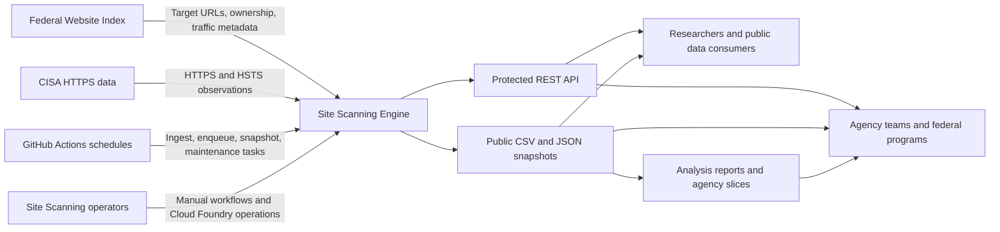
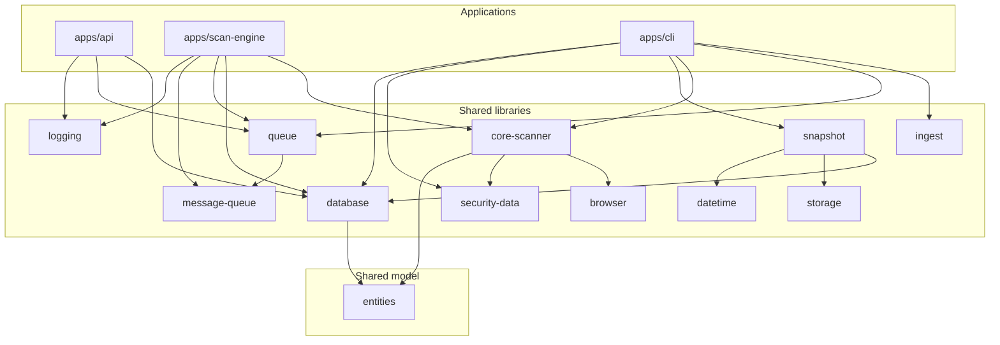
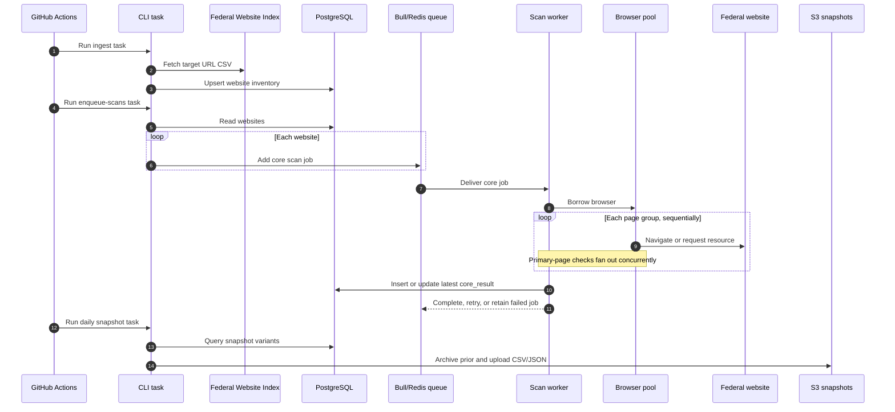
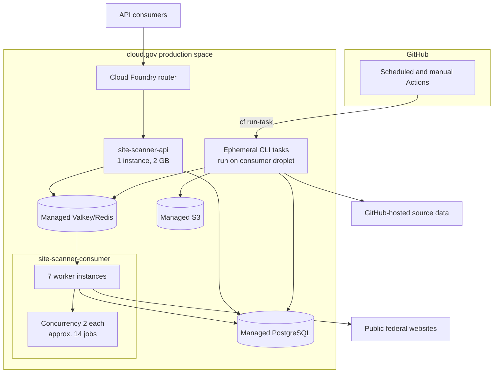
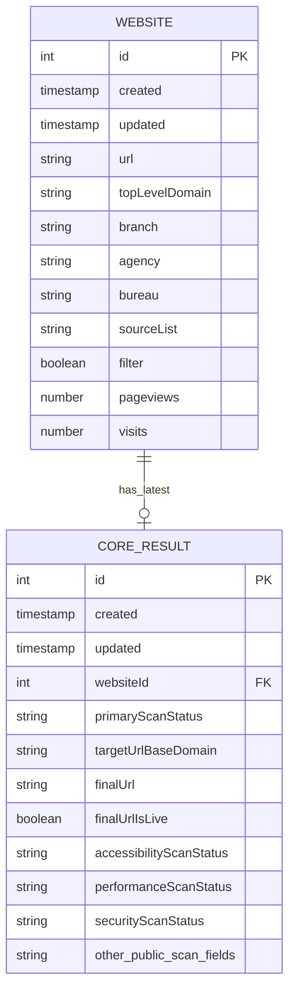

# Architecture Description: Site Scanning Engine

## 1. Purpose And Scope

The Site Scanning Engine inventories public federal websites, visits them with
a real browser and supporting network checks, stores the latest observations,
and publishes those observations through an API and bulk snapshots. This
architecture description supports onboarding, operation, impact analysis,
product planning, and future system evolution.

The system boundary includes this repository's API, worker, CLI, shared
libraries, database model, queue integration, and snapshot publisher. It does
not include construction of the Federal Website Index, the CISA source data,
downstream analysis repositories, public report pages, or API gateway policy.

### External Context

Source: [`diagrams/system-context.mmd`](diagrams/system-context.mmd).

## 2. Stakeholders And Concerns

| Stakeholder                                                  | Role                                         | Main concerns                                                       | Type                |
| ------------------------------------------------------------ | -------------------------------------------- | ------------------------------------------------------------------- | ------------------- |
| Federal agency web teams                                     | Data subjects and consumers                  | Correct site ownership, actionable findings, understandable caveats | Functional, quality |
| OMB and policy programs                                      | Portfolio oversight                          | Coverage, comparable measures, trends, policy adoption              | Functional, quality |
| TTS programs such as DAP, USWDS, Search.gov, and Touchpoints | Service owners and consumers                 | Adoption, configuration, market discovery, targeted outreach        | Functional          |
| CISA and security stakeholders                               | Security consumers and source-data providers | Third-party exposure, HTTPS/HSTS provenance, freshness              | Functional, quality |
| Researchers and public consumers                             | Bulk-data and API users                      | Stable fields, reproducibility, access, documentation               | Interface, quality  |
| Site Scanning operators                                      | Production operators                         | Queue health, scan failures, recovery, deployment safety            | Quality, constraint |
| Maintainers                                                  | Engineers                                    | Comprehensibility, testability, safe schema and scan changes        | Quality             |
| Authorizing officials and security reviewers                 | Governance                                   | Boundary, dependencies, data handling, evidence, change control     | Constraint, quality |
| Program leadership                                           | Sponsors                                     | Impact, usage, cost, staffing, prioritization, continuity           | Business, quality   |

Concerns most likely to evolve are policy measures, desired scans, source-list
coverage, consumer access patterns, browser behavior, and platform services.
The public field contract and the limited staffing model make changes in these
areas architectural rather than local implementation details.

## 3. Viewpoint Coverage

| Concern                                                      | Viewpoint                            | View                  |
| ------------------------------------------------------------ | ------------------------------------ | --------------------- |
| What is inside the product and what supplies or consumes it? | System context                       | External context      |
| How is source code divided and where should a change go?     | Module decomposition                 | Module view           |
| How does a target become a published result?                 | Component-and-connector and sequence | Runtime scan flow     |
| Where does production software run and scale?                | Deployment/allocation                | Production deployment |
| What is retained and how are records related?                | Information/data                     | Data model            |
| Why does the system have its current shape?                  | Decision                             | Significant decisions |

## 4. Module View

This static view serves maintainers. It shows implementation responsibilities,
not runtime processes or deployment instances.

Source: [`diagrams/module-view.mmd`](diagrams/module-view.mmd).

### Applications

| Application | Responsibility                                                            | Entry point                                                          |
| ----------- | ------------------------------------------------------------------------- | -------------------------------------------------------------------- |
| API         | Authenticated REST access, pagination/filtering, Swagger, analysis counts | [`apps/api/src/main.ts`](../../apps/api/src/main.ts)                 |
| Scan engine | Long-running Bull consumer that scans and persists results                | [`apps/scan-engine/src/main.ts`](../../apps/scan-engine/src/main.ts) |
| CLI         | Ingest, enqueue, direct scan, data refresh, and snapshot commands         | [`apps/cli/src/main.ts`](../../apps/cli/src/main.ts)                 |

### Libraries

| Library         | Responsibility                                                        |
| --------------- | --------------------------------------------------------------------- |
| `browser`       | Puppeteer browser pool, page lifecycle, timeout, and request controls |
| `core-scanner`  | Page-group orchestration and individual scan checks                   |
| `database`      | TypeORM connection, repositories, persistence mapping, API queries    |
| `message-queue` | Bull queue registration and Redis/Valkey connection                   |
| `queue`         | Producer and queue status/cleanup operations                          |
| `ingest`        | Federal Website Index CSV parsing and website upserts                 |
| `snapshot`      | Snapshot selection, serialization, rotation, and publication          |
| `storage`       | S3-compatible object operations                                       |
| `security-data` | HTTPS/HSTS source refresh, lookup, and source freshness               |
| `logging`       | Pino configuration and metric-shaped structured logs                  |
| `datetime`      | Injectable clock used by snapshot date handling                       |

## 5. Runtime View

This component-and-connector view serves operators, developers, and data
consumers. It shows the principal end-to-end path.

Source: [`diagrams/runtime-flow.mmd`](diagrams/runtime-flow.mmd).

### Runtime Details

1. Ingest reads the Federal Website Index CSV, converts its source-list flags
   into one list, and upserts `Website` records. Rows absent from a successful
   refresh are removed. See
   [`libs/ingest/src/ingest.service.ts`](../../libs/ingest/src/ingest.service.ts).
2. Enqueue creates one `core` job per website with site metadata and a scan ID.
   See [`apps/cli/src/queue.controller.ts`](../../apps/cli/src/queue.controller.ts).
3. Each job allows three total attempts with exponential backoff beginning at
   30 seconds. Completed jobs are removed; final failed jobs are retained. See
   [`libs/queue/src/queue.service.ts`](../../libs/queue/src/queue.service.ts).
4. DNS resolution, invalid certificates, and SSL cipher/version mismatch are
   treated as permanent failures and are persisted without retry. Other thrown
   failures are retried, and the final failure is persisted. See
   [`apps/scan-engine/src/scan-engine.consumer.ts`](../../apps/scan-engine/src/scan-engine.consumer.ts).
5. The core scanner iterates the nine page groups in enum order. The primary
   page loads once and runs 13 extraction checks concurrently. Failure of one
   primary check returns a null result for that check; failure of a page group
   creates a page-specific scan status. See
   [`libs/core-scanner/src/core-scanner.service.ts`](../../libs/core-scanner/src/core-scanner.service.ts)
   and [`libs/core-scanner/src/pages/primary.ts`](../../libs/core-scanner/src/pages/primary.ts).
6. Persistence flattens page results into `CoreResult` and updates or inserts
   the single latest result associated with the website. See
   [`libs/database/src/core-results/core-result.service.ts`](../../libs/database/src/core-results/core-result.service.ts).
7. Snapshot publication produces all, live, live-filtered, and
   live-filtered-unique CSV/JSON variants plus a separate accessibility detail
   JSON snapshot. See
   [`libs/snapshot/src/snapshot.service.ts`](../../libs/snapshot/src/snapshot.service.ts).

### Scan Catalog

| Page group    | Main output                                                                                                                    |
| ------------- | ------------------------------------------------------------------------------------------------------------------------------ |
| Primary       | URL outcome plus DAP, third-party, cookie, SEO, USWDS, login, CMS, required link, feedback, search, mobile, and tooling checks |
| DNS           | IPv6 and recognized host/CDN names                                                                                             |
| Not found     | Response behavior for a random nonexistent path                                                                                |
| Robots.txt    | Detection, response metadata, crawl delay, sitemap references                                                                  |
| Sitemap.xml   | Detection, response metadata, URL/PDF count, last-modified, hash                                                               |
| Accessibility | Automated axe-core violation summary and details                                                                               |
| Performance   | Largest Contentful Paint and Cumulative Layout Shift                                                                           |
| Security      | Lookup in externally maintained HTTPS/HSTS data                                                                                |
| WWW           | Behavior of the `www.`-prefixed target                                                                                         |

## 6. Deployment View

This allocation view serves operators and security reviewers. It maps runtime
software to production infrastructure.

Source: [`diagrams/deployment-view.mmd`](diagrams/deployment-view.mmd).

The manifest deploys one routed API application and seven route-less consumer
instances. CLI commands do not have a persistent application; GitHub Actions
invoke them as Cloud Foundry tasks using the consumer droplet and service
bindings. The API and workers share PostgreSQL and the message queue. Snapshot
tasks additionally require S3 credentials in their execution environment.

## 7. Data View

Source: [`diagrams/data-model.mmd`](diagrams/data-model.mmd).

`Website` stores source inventory and ownership metadata. `CoreResult` stores a
flat, current observation. The one-to-one relationship means rescanning updates
the current row rather than preserving a time series. Historical analysis is
therefore based on archived snapshots outside the operational database.

The public record is assembled at serialization time by merging both entities.
The public bulk contract is explicitly ordered by
`CoreResult.snapshotColumnOrder` in
[`entities/core-result.entity.ts`](../../entities/core-result.entity.ts).

## 8. API And Publication Interfaces

| Interface              | Behavior                                                            |
| ---------------------- | ------------------------------------------------------------------- |
| `GET /websites`        | API-key-protected, paginated current results with supported filters |
| `GET /websites/:url`   | API-key-protected exact initial-domain lookup                       |
| `GET /analysis`        | API-key-protected aggregate and queue counts                        |
| `/api` and `/api-json` | Swagger UI and generated OpenAPI document                           |
| Daily snapshots        | CSV and JSON variants in S3, including permanent dated archives     |
| Accessibility details  | Separate JSON publication for violation-level details               |

In local development only, the API applies the prefix
`/technology/site-scanning/v1`. External production routing and API gateway
paths are outside this repository's boundary.

## 9. Cross-view Consistency

The architecture was reverse-engineered using a synthetic approach: each view
was derived from the code and configuration most relevant to its concern, then
reconciled using these correspondence rules.

| Module element                         | Runtime element                                   | Deployment element                      |
| -------------------------------------- | ------------------------------------------------- | --------------------------------------- |
| `apps/api`                             | REST API process                                  | `site-scanner-api`                      |
| `apps/scan-engine`                     | Bull consumer process                             | Seven `site-scanner-consumer` instances |
| `apps/cli`                             | Short-lived ingest, enqueue, and snapshot process | Cloud Foundry task on consumer droplet  |
| `libs/message-queue` and `libs/queue`  | Producer/consumer connector                       | Managed Valkey/Redis service            |
| `libs/database` and entities           | Persistence connector and current data            | Managed PostgreSQL service              |
| `libs/snapshot` and `libs/storage`     | Publication process                               | Managed S3 service                      |
| `libs/browser` and `libs/core-scanner` | Browser scan execution                            | Consumer instance and remote websites   |

The older diagram under [`../architecture`](../architecture/README.md) mixes
runtime and deployment concerns and depicts a persistent producer that is not
present in the current manifest. Use this document for the current model.

## 10. Significant Decisions, Assumptions, And Limitations

These are reconstructed decisions, not formal historical ADRs. Alternatives
reflect the most relevant future choices, not necessarily alternatives recorded
when the code was written.

| Decision                                              | Concern served                         | Alternative                       | Assumption                                       | Trade-off or limitation                                                  |
| ----------------------------------------------------- | -------------------------------------- | --------------------------------- | ------------------------------------------------ | ------------------------------------------------------------------------ |
| Use a NestJS monorepo with shared libraries           | Consistency and reuse                  | Separate repositories/services    | One team can coordinate releases                 | Coupled release and broad dependency graph                               |
| Use real Chrome through Puppeteer                     | Fidelity to modern websites            | HTTP-only or synthetic parser     | Browser behavior is required for useful results  | High memory, latency, and operational complexity                         |
| Separate enqueue from worker execution through Bull   | Throughput and recovery                | Synchronous batch processing      | Redis/Valkey remains available                   | Queue state becomes another operational dependency                       |
| Keep one current result per website                   | Simple API and bounded database        | Append-only scan history          | Snapshots provide enough history                 | No transactional trend queries or reprocessing from raw results          |
| Flatten results into one wide table                   | Simple publication and filtering       | Normalized scan-specific tables   | Public field set changes moderately              | Schema evolution and sparse-column complexity                            |
| Let TypeORM synchronize schema at startup             | Low migration overhead                 | Versioned migrations              | Entity changes are safe for automatic alteration | Weak review, rollback, and audit control for production schema changes   |
| Run CLI work as Cloud Foundry tasks                   | Reuse deployment artifact and bindings | Persistent scheduler/producer app | GitHub Actions remains reliable                  | Operational scheduling is split across GitHub and cloud.gov              |
| Treat selected failures as permanent                  | Avoid futile retries                   | Retry all failures                | Classification reliably predicts permanence      | Misclassification can suppress recovery attempts                         |
| Retry other jobs three times with exponential backoff | Tolerate transient failures            | No retry or adaptive policy       | Most transient failures resolve quickly          | Fixed policy ignores failure class and system load                       |
| Publish stable CSV and JSON snapshots                 | Broad, low-friction access             | API-only access                   | Consumers can process full files                 | Contract changes require careful coordination; CSV truncates long values |
| Use external CISA data for HTTPS/HSTS                 | Reuse authoritative source             | Perform live security checks      | External dataset remains available and current   | Missing source rows look like scan failure unless carefully interpreted  |

### Architectural Constraints

- Cloud.gov and managed service bindings shape deployment and configuration.
- The service scans untrusted public web content; browser isolation, timeouts,
  and request controls are part of the security boundary.
- The public data contract spans this repository, the documentation repository,
  snapshots, the API, and downstream consumers.
- Limited staffing increases the cost of operating parallel publication paths
  and maintaining undocumented behavior.
